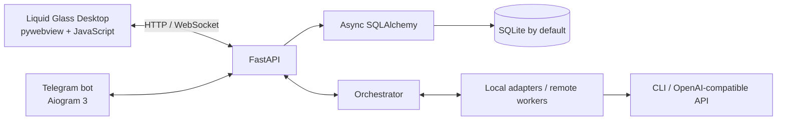

English | [Русский](README.ru.md)

<p align="center"></p>
<h1 align="center">Loomis</h1>
<p align="center"><strong>Turn project requirements into reviewed changes in Git.</strong></p>

Loomis is a local workspace for managing software projects and AI development agents. Collect requirements in Desktop or Telegram, approve the plan, and follow progress and logs in real time.

## Features

- **Requirements and plans in the database.** Collect requirements from text, documents, and images in Desktop or Telegram. The bot also accepts voice notes. Loomis stores requirements and plans in its database, keeping the Git worktree focused on project files.
- **Two-column Desktop workspace.** The IDE layout brings together team and direct chats, terminals, and project controls. An interactive 3D lighter appears on the dashboard and completion screen.
- **Project stages.** Requirements → Plan discussion → Development → Final / Git. You can request plan revisions before approval. After the last development step, the project enters Pending review (`review_pending`). You can approve the result to close the project or request further work.
- **Git workflow.** Loomis creates rollback checkpoints and writes past-tense commit messages without model names. You can configure when commits are pushed to GitHub.
- **Telegram synchronization.** Desktop and the bot share projects, requirements, plans, agents, chats, and approvals. From your phone, you can run the full workflow, review the result, and deliver the project to its linked GitHub repository with a manual push.
- **Model Hub and execution.** Connect CLI and OpenAI-compatible model presets, track reported token usage, set deadlines, and configure handoffs when an agent fails. Loomis supports remote workers.
- **Language.** Choose Russian or English in Desktop under **Settings → Language** or in Telegram under **Account settings → Language**. Both clients use the same account preference.

## Architecture



The backend lives in `backend/`, executor adapters and Git operations in `worker/`, and the Desktop client in `desktop/`. Loomis stores project worktrees in `workspaces/` by default.

## Quick start on Windows

From the repository root in PowerShell:

```powershell
python -m venv .venv
.\.venv\Scripts\Activate.ps1
python -m pip install -r requirements.txt
if (-not (Test-Path .env)) { Copy-Item .env.example .env }
python -m desktop.app
```

The Desktop client starts the local API if needed. To run it directly, use `python -m backend.main`. Set `BOT_TOKEN` to enable Telegram, `SECRET_KEY` to keep API tokens valid across restarts, and `GITHUB_CLIENT_ID` to enable GitHub Device Flow for a configured OAuth app. The default API address is `http://127.0.0.1:8000`.

### Telegram sign-in

Sign in to an existing account, generate a one-time Telegram link in the Desktop integration settings, and open it in Telegram. Once linked, the bot can approve future Desktop sign-ins. Magic Login requests expire after five minutes.

## API

Send `Authorization: Bearer <access_token>` to protected HTTP routes. Desktop authenticates project WebSockets with the `loomis` subprotocol followed by the access token. The full HTTP schema and interactive reference are available in Swagger UI. [Local API docs](http://127.0.0.1:8000/docs)

| Method | Route | Purpose |
| --- | --- | --- |
| GET | `/health` | Check service health |
| POST | `/api/auth/register`, `/api/auth/login` | Register an account or get a bearer token |
| GET / PATCH | `/api/auth/me` | Read the profile or update preferences, including `{"language":"en"}` or `{"language":"ru"}` |
| POST | `/api/auth/generate-link-code`, `/api/auth/telegram/unlink` | Link or disconnect Telegram |
| POST | `/api/auth/magic-login/request` | Request Telegram approval for Desktop sign-in |
| GET | `/api/auth/magic-login/status/{request_id}` | Poll a sign-in request and get the token when approved |
| POST | `/api/auth/github/device/start`, `/api/auth/github/device/poll` | Start or poll GitHub Device Flow |
| POST / DELETE | `/api/auth/github` | Link GitHub with a token or disconnect it |
| GET / POST | `/api/projects` | List or create projects |
| GET | `/api/projects/dashboard-usage` | Read dashboard token usage |
| GET / PATCH / DELETE | `/api/projects/{project_id}` | Read, update, or delete a project |
| GET / POST | `/api/projects/{project_id}/spec-items` | List or add specification entries |
| POST | `/api/projects/{project_id}/open-folder` | Open the project folder on the machine running the API |
| POST | `/api/projects/{project_id}/actions` | Run project lifecycle actions |
| POST | `/api/projects/{project_id}/chat`, `/api/projects/{project_id}/council/feedback` | Message agents or submit plan feedback |
| POST | `/api/projects/{project_id}/agents/{agent_id}/question` | Ask an agent a question |
| GET / POST | `/api/projects/{project_id}/agents` | List or add agents |
| GET / PATCH / DELETE | `/api/projects/{project_id}/agents/{agent_id}` | Read, update, or remove an agent |
| POST | `/api/projects/{project_id}/agents/test`, `/api/projects/{project_id}/agents/from-hub`, `/api/projects/{project_id}/agents/{agent_id}/retry` | Test a configuration, import a preset, or resume an agent |
| POST | `/api/projects/{project_id}/approvals/{key}`, `/api/projects/{project_id}/clear-view` | Resolve an approval or clear a chat view |
| POST / GET | `/api/projects/{project_id}/media`, `/api/projects/{project_id}/media/{media_id}` | Upload or retrieve project media |
| GET | `/api/projects/{project_id}/history`, `/api/projects/{project_id}/stats`, `/api/projects/{project_id}/commits` | Read history, statistics, or Git commits |
| POST | `/api/projects/{project_id}/push`, `/api/projects/{project_id}/commits/{commit_hash}/rollback` | Push commits or roll back to a commit |
| GET / POST | `/api/hub/models` | List or create model presets |
| PATCH / DELETE | `/api/hub/models/{preset_id}` | Update or delete a model preset |
| GET | `/api/hub/leaderboard` | Read model reliability and latency |
| WS | `/ws/{project_id}` | Stream project status and events |
| WS | `/ws/workers` | Connect a remote worker using the shared worker secret |

## License

Loomis is available under the [PolyForm Noncommercial License 1.0.0](LICENSE). Copyright © 2026 3xstar.

You may run and use Loomis free of charge for personal and noncommercial purposes within the terms of the license. Commercial use, resale, and integration into paid products require separate written permission from the copyright holder.
