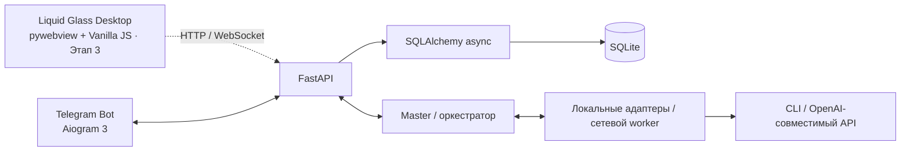

<h1 align="center">Loomis</h1>
<p align="center"><strong>От первого сообщения с ТЗ до проверенного изменения в Git.</strong></p>

<p align="center">
  
  
  
  
  
  
</p>

Loomis — локальная система управления проектами и агентами разработки. Соберите требования в Telegram, запустите консилиум и утвердите план. FastAPI управляет проектами и передаёт в реальном времени статусы и журналы выполнения.

## Возможности

- **Проекты и ТЗ.** Telegram-бот принимает текст, PDF, DOCX и голосовые сообщения, собирая требования в `SPEC.md` рабочей копии проекта.
- **Telegram-бот.** Регистрация и привязка аккаунта, карточки проектов, управление буфером ТЗ и прямой чат с агентами.
- **Консилиум агентов.** Master координирует CLI-агентов и агентов через OpenAI-совместимый API. Консилиум формирует `PLAN.md`, который пользователь утверждает перед запуском. Задачи могут выполняться на сетевых воркерах.
- **Журналы в реальном времени.** WebSocket передаёт статусы и события проекта. Loomis сохраняет результаты работы агентов и расход токенов, когда провайдер или CLI сообщает об использовании.
- **Git rollback.** Loomis создаёт точки отката и позволяет откатить последний шаг при приостановленном или завершённом проекте.
- **Liquid Glass Desktop и Magic Login.** Этап 3 добавляет настольный интерфейс на pywebview и Vanilla JS. API поддерживает вход с подтверждением через Telegram.

## Архитектура



### Структура каталогов

```text
backend/
├── api/            HTTP API, авторизация и WebSocket
├── bot/            Telegram-команды, меню и приём ТЗ
├── core/           Оркестратор, консилиум, документы и голос
├── database/       Асинхронные модели и подключение к БД
└── main.py         Точка входа FastAPI
worker/
├── adapters/       CLI- и API-адаптеры агентов
├── git_bridge.py   Git-операции и откат
└── worker_node.py  Точка входа сетевого воркера
desktop/            Настольный клиент Этапа 3
workspaces/         Локальные рабочие копии проектов
temp_uploads/       Временные загрузки
```

## Быстрый старт · Windows PowerShell

Из корня проекта создайте виртуальное окружение и установите зависимости.

```powershell
python -m venv .venv
.\.venv\Scripts\Activate.ps1
python -m pip install -r requirements.txt
if (-not (Test-Path .env)) { Copy-Item .env.example .env }
```

Если `.env` уже есть, сохраните его и добавьте недостающие настройки из `.env.example`. Для Telegram задайте `BOT_TOKEN`, для сохранения сессий после перезапуска — постоянный случайный `SECRET_KEY`.

```powershell
uvicorn backend.main:app --host 127.0.0.1 --port 8000
```

Swagger UI доступен по адресу [http://127.0.0.1:8000/docs](http://127.0.0.1:8000/docs), проверка состояния — по `GET /health`. Чтобы запустить сервер с адресом и портом из настроек Loomis, используйте `python -m backend.main`.

Этап 3 «Liquid Glass Desktop + Magic Login» полностью реализован и готов к запуску из корня проекта с активированным окружением.

```powershell
python -m desktop.app
```

Клиент запускает API автоматически, если `/health` недоступен. В окне доступны темы Dark Liquid Glass и Light iOS Glass. Выбор темы сохраняется между запусками.

### Переменные окружения

| Переменная | По умолчанию | Назначение |
| --- | --- | --- |
| `BOT_TOKEN` | Пусто | Токен Telegram-бота. При пустом значении бот не запускается. |
| `API_HOST` | `127.0.0.1` | Адрес сервера при запуске через `python -m backend.main`. |
| `API_PORT` | `8000` | Порт сервера при запуске через `python -m backend.main`. |
| `DATABASE_URL` | `sqlite+aiosqlite:///./loomis.db` | Строка подключения асинхронного SQLAlchemy. |
| `SECRET_KEY` | Временный ключ процесса | Подписывает токены API. Постоянный ключ сохраняет их действие после перезапуска до истечения срока. |
| `LOOMIS_WORKER_TOKEN` | Пусто | Общий секрет Master и сетевого воркера. |
| `WHISPER_MODEL` | `base` | Модель faster-whisper для расшифровки аудио. Загружается при первом обращении. |

## API

Для защищённых HTTP-маршрутов и WebSocket проекта передавайте `Authorization: Bearer <access_token>`.

| Метод | Маршрут | Назначение |
| --- | --- | --- |
| POST | `/api/auth/register` | Зарегистрировать аккаунт. |
| POST | `/api/auth/login` | Получить Bearer-токен. |
| GET | `/api/auth/me` | Получить профиль текущего пользователя. |
| POST | `/api/auth/generate-link-code` | Получить одноразовый код привязки Telegram. |
| GET / POST | `/api/projects` | Получить список проектов или создать проект. |
| GET / PATCH / DELETE | `/api/projects/{project_id}` | Прочитать, изменить или удалить проект. |
| POST | `/api/projects/{project_id}/actions` | Запустить консилиум, утвердить план, приостановить, возобновить или откатить шаг. |
| POST | `/api/projects/{project_id}/agents/{agent_id}/question` | Задать вопрос агенту. |
| WS | `/ws/{project_id}` | Получать статусы и события проекта. |
| WS | `/ws/workers` | Подключить сетевой воркер с общим секретом. |
| POST | `/api/auth/magic-login/request` | Запросить вход через Telegram. |
| GET | `/api/auth/magic-login/status/{request_id}` | Проверить статус запроса и получить Bearer-токен после подтверждения. |

### Magic Login

1. Клиент отправляет логин пользователя в `POST /api/auth/magic-login/request` и получает `request_id`. Аккаунт должен быть привязан к Telegram, а бот — запущен.
2. Бот присылает запрос, который пользователь подтверждает или отклоняет в Telegram. Запрос действует пять минут.
3. Клиент проверяет статус по `request_id`. После подтверждения API возвращает Bearer-токен для открытия сессии.

Сейчас привязка Telegram выполняется из существующего аккаунта. Войдите через `/api/auth/login`, получите код в `/api/auth/generate-link-code` и передайте его боту через `/link`. Код действует пять минут и используется один раз.

## Этапы проекта

| Этап | Содержание | Состояние |
| --- | --- | --- |
| 1 · База | FastAPI, SQLite, аккаунты, Telegram-бот, проекты и сборка ТЗ | Реализован |
| 2 · Агенты | CLI/API-адаптеры, консилиум, утверждение плана, Git-откат и сетевые воркеры | Реализован, проверка с реальными провайдерами указана в `STATE.md` как следующий шаг |
| 3 · Desktop | Liquid Glass Desktop на pywebview и Vanilla JS, Magic Login | Реализован |

## Безопасность и локальность

- API по умолчанию слушает `127.0.0.1`, а SQLite хранит данные локально в `loomis.db`.
- Telegram и внешние провайдеры агентов обмениваются данными с Loomis по сети при включении соответствующих интеграций. Для сетевых воркеров используйте общий секрет и TLS (`wss://`).
- Храните секреты в `.env`. Дочерние команды внешних CLI ограничиваются песочницей соответствующего CLI или ОС. Доверяйте только проверенным конфигурациям агентов и Git-репозиториям.

## Лицензия и статус

Файл лицензии в репозитории отсутствует.

**Loomis · Stage 3.**
