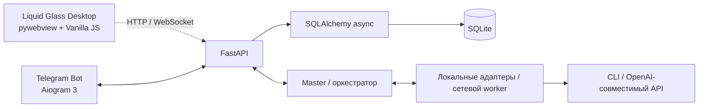

[English](README.md) | Русский

<p align="center"></p>
<h1 align="center">Loomis</h1>
<p align="center"><strong>От первого сообщения с ТЗ до проверенного изменения в Git.</strong></p>

<p align="center">
  
  
  
  
  
  
</p>

Loomis — локальная система управления проектами и агентами разработки. Соберите требования в Telegram, запустите консилиум и утвердите план. FastAPI управляет проектами и передаёт в реальном времени статусы и журналы выполнения.

## Возможности

- **ТЗ и план в БД.** Собирайте требования из текста, документов и изображений в Desktop и Telegram. Бот также принимает голосовые сообщения. Loomis хранит ТЗ и утверждаемый план в БД, оставляя рабочий репозиторий для файлов проекта.
- **Двухколоночный Desktop.** IDE-компоновка объединяет общий и личные чаты, терминалы и управление проектом. Интерактивная 3D-зажигалка появляется на стартовом экране и после завершения проекта.
- **Этапы проекта.** «Сбор ТЗ» → «Обсуждение плана» → «Разработка» → «Финал / Git». План можно вернуть на доработку перед утверждением. После последнего шага проект получает статус «На проверке» (`review_pending`). Пользователь проверяет результат и подтверждает завершение или запрашивает доработку.
- **Git.** Loomis создаёт точки отката и формирует сообщения коммитов в прошедшем времени без имён моделей. Режим отправки в GitHub настраивается.
- **Синхронизация с Telegram.** Desktop и бот работают с общими проектами, ТЗ, планами, агентами, чатами и подтверждениями. С телефона можно пройти весь рабочий цикл, включая проверку результата и выгрузку проекта в связанный репозиторий GitHub через ручной push.
- **Хаб моделей и выполнение.** Подключайте пресеты CLI и OpenAI-совместимых моделей, отслеживайте расход токенов, задавайте дедлайны и настраивайте передачу работы при сбое. Поддерживаются сетевые воркеры.

## Архитектура



### Структура каталогов

```text
backend/
├── api/            HTTP API, авторизация и WebSocket
├── bot/            Telegram-команды, меню и приём ТЗ
├── core/           Оркестратор, консилиум, документы и голос
├── database/       Асинхронные модели и подключение к БД
└── main.py         Точка входа FastAPI
worker/
├── adapters/       CLI- и API-адаптеры агентов
├── git_bridge.py   Git-операции и откат
└── worker_node.py  Точка входа сетевого воркера
desktop/            Настольный клиент
workspaces/         Локальные рабочие копии проектов
temp_uploads/       Временные загрузки
```

## Быстрый старт · Windows PowerShell

Из корня проекта создайте виртуальное окружение и установите зависимости.

```powershell
python -m venv .venv
.\.venv\Scripts\Activate.ps1
python -m pip install -r requirements.txt
if (-not (Test-Path .env)) { Copy-Item .env.example .env }
```

Если `.env` уже есть, сохраните его и добавьте недостающие настройки из `.env.example`. Для Telegram задайте `BOT_TOKEN`, для сохранения сессий после перезапуска — постоянный случайный `SECRET_KEY`.

```powershell
uvicorn backend.main:app --host 127.0.0.1 --port 8000
```

Swagger UI доступен по адресу [http://127.0.0.1:8000/docs](http://127.0.0.1:8000/docs), проверка состояния — по `GET /health`. Чтобы запустить сервер с адресом и портом из настроек Loomis, используйте `python -m backend.main`.

Запустите десктопный клиент из корня проекта в активированном окружении.

```powershell
python -m desktop.app
```

Клиент запускает API автоматически, если `/health` недоступен. В окне доступны темы Dark Monochrome Liquid Glass и Light Monochrome Liquid Glass. Выбор темы сохраняется между запусками.

### Генераторы изображений

В Хабе или в настройках агента выберите роль «Генератор изображений» и укажите OpenAI-совместимый API с маршрутом `/images/generations`. На карточке модели появится бейдж `IMG`. При подключении Loomis проверяет модель пробной генерацией.

Универсальные модели участвуют в консилиуме и могут назначить генератору шаг в плане. Loomis создаёт PNG по указанному пути, показывает миниатюру в Общем чате ИИ и передаёт ход следующему исполнителю. Для генерации вне плана отправьте описание в личный чат художника или обратитесь к нему через `@Имя` в Общем чате. Эти файлы сохраняются в `assets/generated/` проекта.

### Переменные окружения

| Переменная | По умолчанию | Назначение |
| --- | --- | --- |
| `BOT_TOKEN` | Пусто | Токен Telegram-бота. При пустом значении бот не запускается. |
| `API_HOST` | `127.0.0.1` | Адрес сервера при запуске через `python -m backend.main`. |
| `API_PORT` | `8000` | Порт сервера при запуске через `python -m backend.main`. |
| `DATABASE_URL` | `sqlite+aiosqlite:///./loomis.db` | Строка подключения асинхронного SQLAlchemy. |
| `SECRET_KEY` | Временный ключ процесса | Подписывает токены API. Постоянный ключ сохраняет их действие после перезапуска до истечения срока. |
| `LOOMIS_WORKER_TOKEN` | Пусто | Общий секрет Master и сетевого воркера. |
| `WHISPER_MODEL` | `base` | Модель faster-whisper для расшифровки аудио. Загружается при первом обращении. |

## API

Для защищённых HTTP-маршрутов передавайте `Authorization: Bearer <access_token>`. Для WebSocket проекта Desktop передаёт подпротокол `loomis`, за которым следует токен доступа.

| Метод | Маршрут | Назначение |
| --- | --- | --- |
| POST | `/api/auth/register` | Зарегистрировать аккаунт. |
| POST | `/api/auth/login` | Получить Bearer-токен. |
| GET / PATCH | `/api/auth/me` | Получить профиль или обновить настройки, включая язык `ru` / `en`. |
| POST | `/api/auth/generate-link-code` | Получить одноразовый код привязки Telegram. |
| GET / POST | `/api/projects` | Получить список проектов или создать проект. |
| GET / PATCH / DELETE | `/api/projects/{project_id}` | Прочитать, изменить или удалить проект. |
| POST | `/api/projects/{project_id}/open-folder` | Открыть папку проекта на компьютере, где запущен API. |
| POST | `/api/projects/{project_id}/actions` | Запустить обсуждение, утвердить план, управлять выполнением или подтвердить завершение. |
| POST | `/api/projects/{project_id}/chat` | Отправить сообщение выбранным агентам в общий чат. |
| POST | `/api/projects/{project_id}/council/feedback` | Отправить замечания для пересборки плана. |
| POST | `/api/projects/{project_id}/agents/{agent_id}/question` | Задать вопрос агенту. |
| GET | `/api/hub/leaderboard` | Получить рейтинг и среднюю задержку моделей. Требуется Bearer-токен. |
| WS | `/ws/{project_id}` | Получать статусы и события проекта. |
| WS | `/ws/workers` | Подключить сетевой воркер с общим секретом. |
| POST | `/api/auth/magic-login/request` | Запросить вход через Telegram. |
| GET | `/api/auth/magic-login/status/{request_id}` | Проверить статус запроса и получить Bearer-токен после подтверждения. |

### Поиск, рейтинг и кэш ответов

- OpenAI-совместимые API-агенты с поддержкой Function Calling могут искать публичные источники через `web_search` (DDGS) и читать их через `read_webpage` (Jina Reader). Ключ для этих сервисов не требуется. Результаты поиска хранятся в памяти 15 минут. Чтение ограничено 15 секундами и 8000 символами. Внешние сервисы могут ограничивать частоту запросов.
- Хаб показывает надёжность модели в виде бейджа `★ 98%`. Успешные вызовы приближают рейтинг к 100%, ошибки снижают его. При одинаковом рейтинге приоритет получает модель с меньшей средней задержкой успешных вызовов. Оркестратор исключает из выбора агентов в cooldown.
- Текстовые вопросы, обсуждение и сборка плана при температуре до 0.2 используют кэш ответов SQLite/PostgreSQL на 24 часа. SHA-256 учитывает модель, системный промпт и полный пользовательский запрос с контекстом. Вложения и вызовы на изменение файлов обходят кэш. Для API-агента можно переопределить температуру в `settings.temperature`. Сетевой воркер должен объявить совместимую модель и температуру при подключении, чтобы Master использовал кэш для его ответов.

### Magic Login

1. Клиент отправляет логин пользователя в `POST /api/auth/magic-login/request` и получает `request_id`. Аккаунт должен быть привязан к Telegram, а бот — запущен.
2. Бот присылает запрос, который пользователь подтверждает или отклоняет в Telegram. Запрос действует пять минут.
3. Клиент проверяет статус по `request_id`. После подтверждения API возвращает Bearer-токен для открытия сессии.

Сейчас привязка Telegram выполняется из существующего аккаунта. Войдите через `/api/auth/login`, получите код в `/api/auth/generate-link-code` и передайте его боту через `/link`. Код действует пять минут и используется один раз.

## Настройки и Git в Telegram

Язык аккаунта можно сменить в Desktop на вкладке «Язык» в настройках или в Telegram через «⚙️ Настройки аккаунта» → «Язык / Language». Настройка сохраняется в общем профиле.

- В «⚙️ Настройки аккаунта» можно задать общую папку проектов на ПК, переключить доставку рабочих логов и привязать GitHub. Для входа включите Device Flow в настройках GitHub OAuth App и задайте `GITHUB_CLIENT_ID` в `.env`. Бот выдаёт код и сообщает о результате. Отвязка требует подтверждения.
- При создании и в настройках проекта доступны имя, каталог на ПК, дедлайн, режимы работы, передачи при сбое, отчётов, коммитов и автопуша. После привязки GitHub можно указать существующий репозиторий или создать публичный либо приватный.
- Хаб и список агентов показывают специализацию `[IMG]` и рейтинг надёжности, когда накоплена статистика. Агента в состоянии ошибки можно перезапустить с сохранённого шага, если для текущего плана есть сохранённый контекст.
- Нижнее меню проекта открывает историю коммитов, ручной push и мягкую очистку чатов. Откат требует подтверждения, сбрасывает рабочую копию и восстанавливает снимок контекста выбранного коммита при его наличии. Очистка скрывает историю из последующих выдач Loomis и сохраняет контекст агентов.

## Безопасность и локальность

- API по умолчанию слушает `127.0.0.1`, а SQLite хранит данные локально в `loomis.db`.
- Telegram и внешние провайдеры агентов обмениваются данными с Loomis по сети при включении соответствующих интеграций. Для сетевых воркеров используйте общий секрет и TLS (`wss://`).
- Храните секреты в `.env`. Дочерние команды внешних CLI ограничиваются песочницей соответствующего CLI или ОС. Доверяйте только проверенным конфигурациям агентов и Git-репозиториям.

## Лицензия

Loomis распространяется по лицензии [PolyForm Noncommercial License 1.0.0](LICENSE). Авторские права © 2026 3xstar.

Лицензия разрешает бесплатно запускать и использовать Loomis в личных и некоммерческих целях в пределах её условий. Для коммерческого использования, перепродажи или встраивания в платные продукты требуется отдельное письменное разрешение автора.
